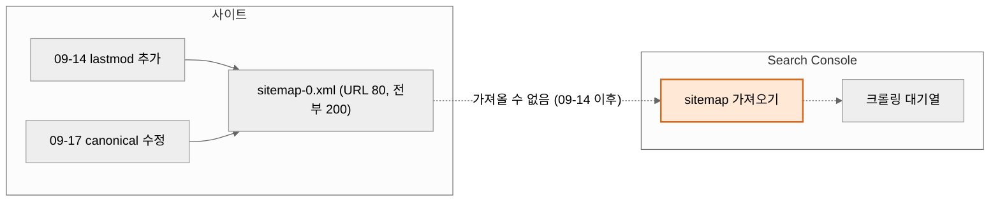

두 달 전에 이 블로그의 검색 노출을 고쳤다. sitemap에 `lastmod`를 넣었고, 목록 페이지의 canonical이 홈을 가리키던 것을 바로잡았고, 빌드 산출물을 검사하는 CI도 붙였다. 고친 것은 "막고 있던 장애물"이니 2~3주 뒤 색인 수로 판정하자고 적어 두었다.

판정 날짜가 지나서 다시 열었다. 그사이 글이 네 편 늘었는데 **네 편 모두 Google이 존재를 모르는 URL**이었다.

원인은 고친 내용이 아니라 고친 내용을 전하는 통로에 있었다. **Search Console은 sitemap을 제출한 날부터 한 번도 읽지 못하고 있었다.**

---

## 1. 증상: 파일은 멀쩡한데 Google이 아는 URL이 18개

먼저 사이트 쪽을 쟀다. Googlebot 이름표를 달고 sitemap을 받아 XML로 파싱하고, 안에 든 URL을 전부 불렀다.

```python
import xml.etree.ElementTree as ET
import urllib.request as R

UA = "Mozilla/5.0 (compatible; Googlebot/2.1)"
NS = {"s": "http://www.sitemaps.org/schemas/sitemap/0.9"}

def get(url, method="GET"):
    req = R.Request(url, method=method, headers={"User-Agent": UA})
    return R.urlopen(req, timeout=15)

body = get("https://leekh8.github.io/sitemap-0.xml").read()
locs = [u.find("s:loc", NS).text for u in ET.fromstring(body)]
print(len(locs), "개 파싱")

bad = []
for u in locs:
    try:
        code = get(u, "HEAD").status
    except Exception as e:
        code = getattr(e, "code", str(e))
    if code != 200:
        bad.append((code, u))
print("200 아닌 것", bad)
```

```
80 개 파싱
200 아닌 것 []
```

`sitemap-index.xml`, `sitemap-0.xml`, `robots.txt` 셋 다 200이고 sitemap은 `application/xml`로 나간다. robots.txt는 sitemap 주소를 알려 주고 있고 막는 것은 `/*?q=` 하나뿐이다.

같은 날 Search Console의 페이지 색인 보고서는 이랬다(데이터 기준 11월 16일).

| 항목 | 값 |
|---|--:|
| sitemap에 든 URL | 80 |
| 색인됨 | 8 |
| 색인 안 됨 | 10 |
| **Google이 아는 URL 합계** | **18** |

80개 중 62개는 색인 실패가 아니다. **색인 실패 목록에도 없다.** Google이 아예 모르는 주소다.

---

## 2. 새 글 네 편: "Google에 알려지지 않은 URL"

최근 네 편을 URL 검사에 하나씩 넣었다. 결과가 네 번 다 같았다.

```
URL이 Google에 등록되어 있지 않음
페이지 색인이 생성되지 않음: Google에는 아직 알려지지 않은 URL입니다.

Sitemaps        감지된 참조 사이트맵이 없습니다.
참조 페이지      감지된 페이지 없음
최근 크롤링      해당사항 없음
```

Google 도움말은 이 상태를 한 문장으로 정의한다. "Google hasn't seen this URL before."[^url-inspection] 크롤링해 보고 거른 것이 아니라 **본 적이 없다.**

여기서 눈여겨볼 줄은 `감지된 참조 사이트맵이 없습니다`다. 네 편 모두 sitemap에 들어 있는데 Google은 그 sitemap을 통해 이 글을 알게 된 적이 없다.

---

## 3. 원인: sitemap을 제출한 날부터 한 번도 못 읽었다

Sitemaps 화면을 열었다.

| Sitemap | 유형 | 제출 | 마지막으로 읽은 날짜 | 상태 | 발견된 페이지 |
|---|---|---|---|---|--:|
| `/sitemap-0.xml` | 알 수 없음 | 2026-09-14 | (없음) | **가져올 수 없음** | 0 |
| `/sitemap-index.xml` | Sitemap 색인 | 2026-09-14 | **2024-05-08** | 성공 | 0 |

두 줄 모두 문제다.

- `sitemap-0.xml`은 제출한 9월 14일부터 71일 동안 "가져올 수 없음"이고 읽은 날짜가 비어 있다.
- `sitemap-index.xml`은 상태가 "성공"이다. 그런데 마지막으로 읽은 날짜가 **2024년 5월 8일**이다. 9월 14일에 다시 제출했지만 Google은 그 뒤로 이 파일을 다시 가져가지 않았다.

Google 도움말의 두 문장을 같이 놓으면 상황이 정리된다.

| 도움말 문장[^sitemaps-report] | 이 블로그에서 |
|---|---|
| "Last read": "The last time the sitemap was fetched by Google." | 2024-05-08 이후 가져간 적이 없다 |
| "Couldn't fetch": "Google couldn't retrieve the sitemap file itself" | 9월 14일부터 지금까지 |
| 가져오기에 실패하면 "Google will retry for a few days." | 며칠 재시도하고 멈춘 것으로 보인다 |

9월 14일에 넣은 `lastmod`와 9월 17일에 고친 canonical은 **sitemap을 거쳐 Google에 전해질 예정이었다.** 그 통로가 처음부터 닫혀 있었다.



### 그런데 Googlebot은 파일을 받을 수 있다

URL 검사에 sitemap 주소 자체를 넣고 "실제 URL 테스트"를 돌렸다.

```
https://leekh8.github.io/sitemap-0.xml
2026-11-24 오전 11:10에 테스트됨
URL을 Google에 등록할 수 있음
페이지 공개 상태: 페이지 색인을 생성할 수 있음
```

실제 테스트는 Google의 검사 크롤러가 그 주소에 접근할 수 있는지만 본다[^url-inspection]. 그 검사를 통과했다. robots.txt 차단도, 404도, 서버 오류도 아니다.

도움말이 "가져올 수 없음"의 원인으로 드는 것 가운데 남는 것은 하나다. 목록에 **"low crawl demand"**(크롤링 수요가 낮음)가 들어 있다[^sitemaps-report]. 사이트가 고장 난 것이 아니라 **Google이 이 사이트를 다시 볼 이유를 적게 매긴 상태**에서 첫 시도가 실패했고, 재시도 기간이 지나자 다시 오지 않은 것으로 읽힌다. 이 해석은 Google이 확인해 준 것이 아니다. 아래 크롤링 통계와 들어맞는다는 것까지만 말할 수 있다.

---

## 4. 크롤링 통계: 아는 것만 다시 본다

설정 > 크롤링 통계, 최근 90일.

| 항목 | 9월 14일 측정 | 11월 24일 측정 |
|---|--:|--:|
| 총 크롤링 요청 | 665 | 488 |
| 목적: 새로고침 | 98% | 98% |
| 목적: 발견 | 2% | 2% |
| 파일 형식: HTML | 13% | 14% |
| 호스트 문제 | 없음 | 없음 |

요청 488건 중 **새 URL을 찾으러 온 것이 2%**, 10건 남짓이다. 나머지는 이미 아는 페이지와 그 페이지의 JS, JSON, 이미지를 다시 받은 것이다. 요청 수 자체도 두 달 사이 4분의 1이 줄었다.

홈 페이지도 확인했다. 홈은 색인돼 있고 **11월 15일에 마지막으로 크롤링**됐다. 그 시점의 홈 HTML에는 11월 10일에 올린 글로 가는 `<a href>`가 들어 있다. 그런데 그 글은 지금도 "알려지지 않은 URL"이다. **링크가 걸린 페이지를 다시 받아 가는 것과 그 링크를 따라가는 것은 별개로 움직인다.**

---

## 5. 내 판단이 틀렸던 곳: "발견된 페이지 0은 정상"

9월에 이 화면을 보고 적어 둔 메모가 있다.

> 사이트맵 인덱스의 "발견된 페이지 0"은 정상이다. 인덱스에 들어 있는 건 페이지가 아니라 자식 사이트맵이다.

그럴듯해서 확인하지 않았다. 도움말 원문은 반대다.

> "If this is a sitemap index, the number is the count of all URLs in all child sitemaps."[^sitemaps-report]

인덱스의 "발견된 페이지"는 **자식 sitemap들에 든 URL 합계**다. 그러니 0은 정상 값이 아니라 **자식 sitemap을 하나도 못 읽었다는 표시**였다. 9월에 이 숫자를 제대로 읽었으면 그날 원인이 sitemap 쪽에 있다는 것을 알았을 것이다.

같은 화면에서 잘못 읽기 쉬운 것을 정리하면 이렇다.

| 화면 값 | 쉽게 하는 오독 | 실제 뜻 |
|---|---|---|
| 상태 "성공" | 지금 잘 읽히고 있다 | **마지막으로 읽었을 때** 성공했다. 날짜를 같이 봐야 한다 |
| 제출 날짜가 오늘 | 오늘 읽었다 | 제출은 요청일 뿐이다. 읽은 날짜는 따로 있다 |
| 인덱스의 발견된 페이지 0 | 인덱스라서 0이다 | 자식 sitemap에서 URL을 하나도 못 얻었다 |
| 제출 직후 "가져올 수 없음" | 실패했다 | 하루 이틀은 기다려 봐야 한다. **두 달이면 멈춘 것이다** |

---

## 6. 다시 넣는 순서

11월 24일에 한 일이다.

1. **sitemap 두 개를 다시 제출했다.** `sitemap-0.xml`, `sitemap-index.xml`. 제출 날짜가 2026-11-24로 바뀌었고 `sitemap-0.xml`은 제출 직후에도 "가져올 수 없음"으로 남아 있다. 결과는 며칠 뒤에 본다.
2. **새 글 네 편에 URL 검사 "색인 생성 요청"을 보냈다.** 네 편 모두 "색인 생성 요청됨"이 떴다.

색인 생성 요청에 대해 Google이 적어 둔 조건은 셋이다[^recrawl].

- 개별 URL 요청에는 할당량이 있다. 숫자는 공개하지 않는다.
- 같은 URL을 여러 번 요청해도 더 빨리 크롤링되지 않는다.
- 크롤링에는 며칠에서 몇 주가 걸리고, 요청이 검색 결과 포함을 보장하지 않는다.

그래서 요청은 **최근 글 몇 편**에만 쓰고 나머지는 sitemap에 맡긴다. 같은 문서도 URL이 많으면 sitemap을 쓰라고 권한다[^recrawl]. 다만 sitemap 제출도 "힌트"일 뿐이고 Google이 그 파일을 받아 간다는 보장은 없다고 적혀 있다[^build-sitemap]. 이번 일이 그 문장대로 됐다.

### 사이트 쪽에서 같이 고친 것

Google이 다시 읽어 가기 시작했을 때 sitemap이 신뢰를 잃지 않도록 같은 날 세 가지를 고쳤다.

| 항목 | 고치기 전 | 고친 뒤 |
|---|---|---|
| 시리즈 페이지 `lastmod` | 빌드마다 시리즈 17개가 전부 최신 글 날짜로 바뀌었다 | 그 시리즈에 든 글 중 가장 최근 날짜 |
| 프로필의 메일 링크 | `href="/mailto:..."`. 앞의 `/` 때문에 사이트 안 주소가 되어 404 | `mailto:`처럼 스킴이 붙은 주소는 그대로 둔다 |
| 소개, 연락처, 개인정보 링크 | `/about`처럼 끝에 `/`가 없어 GitHub Pages가 `/about/`로 301 | 끝에 `/`를 붙인다 |

첫 줄이 가장 중요하다. Google은 `lastmod`가 "일관되고 확인 가능하게" 정확할 때만 그 값을 쓴다[^build-sitemap]. 글이 안 바뀐 시리즈 페이지의 날짜를 매번 올리면 사이트 전체의 `lastmod`를 믿지 않게 될 수 있다. 바꾼 뒤에는 2023년 글만 든 시리즈가 2023년 날짜를 받는다. 홈, 태그, 검색 페이지는 모든 글을 보여 주므로 최신 글 날짜가 그대로 맞다.

나머지 두 줄은 프로필 영역이 글 페이지마다 들어가 있어서 페이지 수만큼 곱해져 있었다. 배포된 HTML 80쪽을 받아 사이트 안 링크를 전부 따라가 보니 이렇게 나왔다.

```
== 사이트 안 링크: 80건 검사, 문제 226건
     57 끝에 / 가 없어 리디렉션되는 링크 /contact
     56 스킴 앞에 / 가 붙은 링크 /mailto:leekh8.contact@gmail.com
     56 끝에 / 가 없어 리디렉션되는 링크 /privacy-policy
     56 끝에 / 가 없어 리디렉션되는 링크 /about
      1 끝에 / 가 없어 리디렉션되는 링크 /soar-intro
```

마지막 한 줄은 글 본문의 링크로, 없는 슬러그를 가리켜 404였다. 이 검사는 빌드 산출물 검사 스크립트에 넣어 PR마다 돌게 했다.

---

## 7. 판정할 날과 기준

9월에는 판정 날짜만 적고 무엇을 보면 되는지는 "색인 수"로 뭉뚱그렸다. 이번에는 숫자로 적는다.

| 확인할 것 | 지금 (11-24) | 12월 8일에 볼 기준 |
|---|---|---|
| `sitemap-0.xml` 마지막으로 읽은 날짜 | 없음 | 11-24 이후 날짜가 찍혔나 |
| `sitemap-0.xml` 발견된 페이지 | 0 | 80에 가까운가 |
| Google이 아는 URL (색인 + 미색인) | 18 | 늘었나 |
| 새 글 네 편 URL 검사 | 알려지지 않음 | "크롤링됨" 이상인가 |
| 크롤링 목적 중 발견 | 2% | 올랐나 |

첫 줄이 안 바뀌면 나머지는 볼 필요가 없다. 그때는 sitemap 파일 이름을 바꿔 새 sitemap으로 제출하는 것을 시도한다. 이 결과는 이 글의 `update`로 덧붙인다.

---

## 8. 실무 체크리스트

sitemap을 제출한 뒤:

- [ ] 제출 날짜가 아니라 **마지막으로 읽은 날짜**를 본다
- [ ] 상태가 "성공"이어도 읽은 날짜가 오래됐으면 지금 읽히고 있는 것이 아니다
- [ ] sitemap 인덱스의 발견된 페이지가 0이면 자식 sitemap을 못 읽은 것이다
- [ ] "가져올 수 없음"이 일주일을 넘기면 다시 제출하고 날짜를 적어 둔다

sitemap을 고친 뒤:

- [ ] 고친 내용이 전달될 통로(sitemap 읽기)가 열려 있는지 먼저 확인한다
- [ ] 판정 날짜와 함께 **무엇이 얼마가 되면 성공인지** 숫자로 적는다
- [ ] 목록 페이지 `lastmod`는 소속 글의 최신 날짜로 둔다. 빌드 날짜로 두지 않는다

새 글이 안 잡힐 때:

- [ ] URL 검사에서 "알려지지 않은 URL"인지 "크롤링됨 - 색인 안 됨"인지부터 가른다
- [ ] 알려지지 않은 URL이면 글 내용이 아니라 발견 경로(sitemap, 내부 링크)를 본다
- [ ] Googlebot 이름표로 sitemap과 그 안의 URL을 직접 불러 200인지 확인한다

---

## 마무리

9월에 한 조치는 틀리지 않았다. `lastmod`도 canonical도 맞게 고쳤다. 그런데 그 조치는 Google이 sitemap을 읽어야 전해지는 것이었고, 그 읽기가 일어났는지는 확인하지 않았다. 사이트에서 보이는 모든 것이 정상이었기 때문이다. 파일은 200이고, CI는 통과했고, Search Console에는 "성공"이 떠 있었다.

같은 화면 같은 줄에 2024년 날짜가 있었다. 상태 칸만 읽고 날짜 칸을 읽지 않았다.

지난 [빌드 실패 글](/silent-deploy-failure-vercel/)과 같은 모양이다. 사이트가 200이라고 배포가 된 것이 아니었고, sitemap이 200이라고 Google이 읽은 것이 아니었다. **내가 보는 신호를 만드는 쪽과 내가 확인하고 싶은 쪽이 다르다.**

---

## 다음 글에서는

다음 보안 차례에는 [HTTP 보안 헤더 글](/http-security-headers/)에서 예고한 CSP Report-Only 편을 쓴다. 정적 호스팅에서 응답 헤더를 못 바꿀 때 `<meta>`로는 무엇까지 되고 무엇이 안 되는지부터 잰다.

---

## 참고문헌

[^sitemaps-report]: Google. "Sitemaps report - Search Console Help" (Last read 정의, Couldn't fetch 원인 목록과 재시도, sitemap 인덱스의 발견된 페이지 정의). https://support.google.com/webmasters/answer/7451001
[^url-inspection]: Google. "URL Inspection tool - Search Console Help" (URL is unknown to Google 정의, 실제 URL 테스트가 확인하는 범위). https://support.google.com/webmasters/answer/9012289
[^recrawl]: Google Search Central. "Ask Google to recrawl your URLs" (색인 생성 요청 할당량, 반복 요청 효과 없음, 크롤링 소요 기간). https://developers.google.com/search/docs/crawling-indexing/ask-google-to-recrawl
[^build-sitemap]: Google Search Central. "Build and submit a sitemap" (sitemap 제출은 힌트, lastmod 사용 조건, changefreq와 priority 무시). https://developers.google.com/search/docs/crawling-indexing/sitemaps/build-sitemap

---

### 관련 글

- [빌드는 실패했는데 사이트는 멀쩡했다](/silent-deploy-failure-vercel/)
- [Gatsby 블로그 SEO 설정 가이드: Google Search Console, sitemap, robots.txt](/gatsby-seo-setup/)
- [HTTP 보안 헤더 점검: 내 블로그 응답에는 HSTS 하나만 붙어 있었다](/http-security-headers/)
