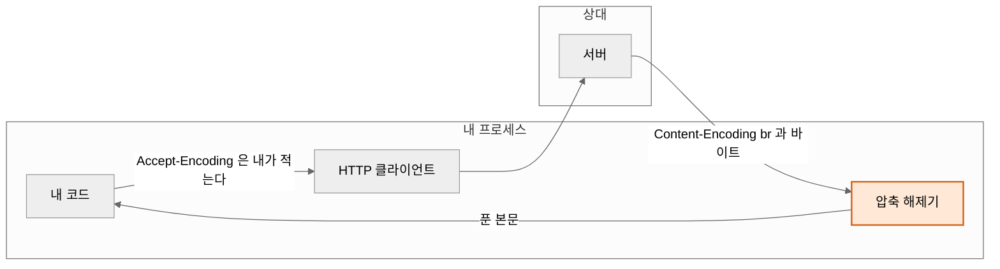

지난 [React 18 SSR NUL 바이트 글](/react18-ssr-nul-bytes/) 끝에 다음은 네트워크 차례라고 적었다. 그 사이에 소재가 왔다.

2026년 10월 21일 Node.js가 보안 릴리스를 냈다[^node-oct2026]. 열 건 중 가장 높은 것이 번들된 Brotli[^rfc7932] 디코더의 경계 밖 쓰기였다. 공지 제목이 이렇다.

> Node.js Brotli decoder out-of-bounds write permits remote code execution (CVE-2026-111497) - (high)[^node-oct2026]

제목만 보고 든 첫 생각은 이것이었다.

> 우리는 brotli 안 쓰는데.

재 봤다. **처음 측정이 틀렸고, 틀린 방향이 하필 안심하는 쪽이었다.**

## 1. 처음 측정: br을 달라고 하지 않는다

로컬에 서버를 띄워 들어오는 `Accept-Encoding`을 그대로 찍었다.

```js
import http from "node:http";

const srv = http.createServer((req, res) => {
  console.log(req.url, req.headers["accept-encoding"]);
  res.end("ok");
});
srv.listen(0, "127.0.0.1");
```

Node 24.11.1에서 나온 값이다.

| 보내는 쪽 | Accept-Encoding |
|---|---|
| `fetch(url)` | `gzip, deflate` |
| `http.get(url)` | (헤더 없음) |

`br`이 없다. 여기서 멈추면 "brotli 디코더는 내 코드에서 안 돌아간다"가 된다. 실제로 그렇게 적어 뒀다가 지웠다.

## 2. 틀린 이유: 서버를 http로 띄웠다

`fetch`의 기본 `Accept-Encoding`은 **스킴에 따라 갈린다.** Node에 번들된 undici 소스에 분기가 그대로 있다[^undici-src].

```js
if (!httpRequest.headersList.contains('accept-encoding', true)) {
  if (urlHasHttpsScheme(requestCurrentURL(httpRequest))) {
    httpRequest.headersList.append('accept-encoding', 'br, gzip, deflate, zstd', true)
  } else {
    httpRequest.headersList.append('accept-encoding', 'gzip, deflate', true)
  }
}
```

내 테스트 서버는 `http://127.0.0.1` 이었다. 그래서 `else` 쪽 값을 재고 있었다. 자체 서명 인증서로 https 서버를 하나 더 띄워 같은 측정을 다시 했다.

| 요청한 스킴 | 서버가 받은 Accept-Encoding |
|---|---|
| `http://127.0.0.1:…` | `gzip, deflate` |
| `https://localhost:…` | **`br, gzip, deflate`** |

`br`이 맨 앞에 있다. 그리고 실제 아웃바운드 요청은 거의 전부 https다. 즉 **기본값 그대로 쓰는 코드가 brotli를 먼저 달라고 하고 있었다.**

> ⚠️ 이 분기는 **Node 공식 문서에 없다.** `doc/api` 전체에서 `accept-encoding`이 나오는 파일은 `zlib.md`와 `http2.md` 둘뿐이고, `fetch`를 다루는 문서에는 없다. 번들된 undici 소스에서만 확인된다.

로컬에서 재는 것은 좋은 습관이지만, **스킴을 바꾸면 값이 바뀌는 코드를 http로 재면 반대 결론이 나온다.** 내가 겪은 것이 정확히 그것이다.

## 3. 그리고 안 달라고 해도 푼다

더 중요한 쪽이 남아 있다. HTTP에서 `Accept-Encoding`은 **요청**이고[^rfc9110-accept-encoding] `Content-Encoding`은 **통보**다[^rfc9110-content-encoding]. 서버가 내가 적어 보낸 목록을 지킬 의무는 명세에 없다.

묻지 않고 늘 brotli로 답하는 서버를 세워 네 가지로 눌러 봤다.

```js
// 요청에 뭐가 적혀 있든 늘 brotli 로 답한다
const body = zlib.brotliCompressSync(Buffer.from("풀렸다", "utf8"));
res.writeHead(200, { "content-encoding": "br" });
res.end(body);
```

| 요청에 적은 것 | 결과 |
|---|---|
| 아무것도 안 적는다 (기본) | **풀어서 준다** |
| `gzip` 만 달라고 한다 | **풀어서 준다** |
| `identity` (압축하지 말라) | **풀어서 준다** |
| `gzip, br;q=0` (br을 거절한다) | **풀어서 준다** |

네 경우 전부 `await r.text()`가 `"풀렸다"`를 돌려줬다. 압축을 쓰지 말라고 명시해도 디코더가 돌았다.

이것은 버그가 아니라 설계다. 클라이언트는 **받은 응답에 적힌 대로** 푼다[^undici]. 적힌 대로 안 풀면 본문을 읽을 방법이 없다.

### 그래서 Accept-Encoding은 방어가 아니다

- `Accept-Encoding`은 내가 **원하는 것**을 적는 칸이다
- 무엇이 돌아올지는 **상대가 고른다**
- 디코더에 들어가는 바이트는 전부 **상대가 만든 것**이다

압축을 안 쓰기로 정했다고 압축 해제 코드가 안 도는 것이 아니다. 압축 해제는 응답을 받는 쪽에서 일어나고, 그 입력은 처음부터 끝까지 상대 것이다. **거기가 신뢰 경계다.**



주황색 칸의 입력은 **내 프로세스 안에 있지만 내가 만든 것이 아니다.** 내가 요청에 무엇을 적었는지는 그 칸에 들어오는 바이트를 바꾸지 못한다.

## 4. 무엇이 어떻게 깨졌나

Node 공지가 적은 원인이 짧고 분명하다.

> An invalid block switch was reported as a temporary need for more input instead of a permanent format error, so the streaming decoder kept appending input bytes to an eight-byte internal buffer.[^node-oct2026]

잘못된 블록 전환을 **영구 형식 오류**로 보고해야 하는데 **입력이 더 필요하다**로 보고했다. 그래서 스트리밍 디코더가 **8바이트 내부 버퍼**에 입력을 계속 이어 붙였다. 지정된 분류가 둘인 것도 이것과 맞물린다. 경계 밖 쓰기(CWE-787)와 **반환값 확인 누락**(CWE-252)이다[^cve-record].

Brotli 쪽 수정 커밋 제목이 "Detect and report invalid stream earlier"다[^brotli-commit]. 여러 함수의 반환형이 참거짓에서 오류 코드로 바뀌었다. 참거짓으로는 "실패"와 "아직 모자람"을 구별할 수 없었다는 뜻이다.

### 심각도가 기관마다 다르다

| 기관 | 등급 |
|---|---|
| Node.js | `high` (CVSS 벡터, 점수를 공지에 적지 않았다)[^node-oct2026] |
| CVE 레코드 (Google) | CVSS 4.0 **9.2 Critical**[^cve-record] |
| NVD | CVSS 3.1 **9.8 Critical**[^nvd] |

세 숫자가 다 원문이다. 한쪽만 인용하면 글이 틀리지는 않아도 좁아진다.

## 5. 아웃바운드 요청이 있으면 이미 물려받았다

이 디코더는 런타임에 **번들**되어 있다(`deps/brotli`)[^node-deps]. 내가 설치하지 않았고 `package.json`에도 없고 의존성 목록을 뒤져도 안 나온다.

닿는 코드는 넓다.

| 흔한 코드 | 왜 닿나 |
|---|---|
| 링크 미리보기, 메타데이터 수집 | 사용자가 넣은 URL을 가져와 본문을 읽는다 |
| 웹훅 검증, 콜백 확인 | 상대 서버의 응답을 읽는다 |
| 크롤러, 사이트맵 생성기 | 임의 주소를 열어 본문을 훑는다 |
| 외부 API 연동 | 그 API가 뚫리거나 중간이 끼면 응답이 바뀐다 |
| 이미지, 파일 내려받기 | 같은 길을 쓴다 |

마지막 줄이 중요하다. 상대가 내 적이 아니어도 된다. **상대가 당하면 내 디코더에 그 바이트가 들어온다.**

`node:zlib`의 공개 API로도 바로 닿는다. 그리고 공식 zlib 문서가 **권하는 HTTP 클라이언트 예시**가 `Accept-Encoding: br,gzip,deflate,zstd`로 요청해서 `case 'br'`에서 `createBrotliDecompress()`로 받는 모양이다[^node-zlib]. 문서가 가르치는 패턴이 그대로 그 경로다.

### SSRF 가드가 이것을 막아 주지 않는다

| | SSRF 가드 | 응답 디코딩 |
|---|---|---|
| 재는 것 | **어디로 가나** (호스트, IP 대역) | **무엇이 돌아오나** (본문 바이트) |
| 막는 것 | 내부망, 메타데이터 끝점[^owasp-ssrf] | (아무것도) |

공개 인터넷 주소로만 나가도록 완벽히 막아도, 그 공개 주소가 돌려주는 바이트는 그대로 디코더에 들어간다. 두 검사는 **다른 축**이라 하나가 다른 하나를 대신하지 못한다.

덧붙여, 많은 SSRF 가드가 **시작 주소만** 보고 그 뒤 리다이렉트와 연결 시점의 DNS 재해석을 다시 안 본다. 가드를 쓰고 있다면 이것도 같이 보는 편이 좋다.

## 6. 고치는 길은 런타임 판뿐이다

| 줄 | 고쳐진 판[^node-oct2026] |
|---|---|
| 26.x | **26.12.1** |
| 24.x | **24.22.1** |
| 22.x | **22.23.4** |

🛑 **번들된 brotli 판 번호로 판정하면 틀린다.** Node는 brotli 버전을 올리지 않고 패치만 역이식했다. 취약한 `v26.12.0`과 고쳐진 `v26.12.1`의 `deps/brotli/c/common/version.h`가 **둘 다 1.2.0**이다[^node-deps]. Brotli 공식 수정판은 1.0.10 / 1.1.1 / 1.2.1인데[^brotli-releases] Node는 그 번호로 가지 않는다. 판정 기준은 **Node 판 번호뿐**이다.

판을 확인한다.

```bash
node --version                 # 내 로컬
```

로컬 판과 실제로 도는 판은 다르다. 선언한 자리를 따로 봐야 한다.

```bash
grep -rn "FROM node:" --include=Dockerfile .
grep -rn "node-version" .github/workflows/
grep -rn "NODE_VERSION" render.yaml vercel.json 2>/dev/null
cat .nvmrc .node-version 2>/dev/null
grep -rn '"node"' package.json        # engines.node
```

이 명령들을 내 프로젝트에 돌려 보고 알게 된 것은, 판이 **적혀 있지 않은 자리가 가장 많다**는 것이었다. `engines.node`도 `.nvmrc`도 없으면 빌드하는 쪽이 자기 기본값을 쓴다. 그러면 "어느 판으로 도는가"에 답할 방법이 없고, 답할 수 없는 것은 올렸는지도 확인할 수 없다.

### 지원이 끝난 줄은 고침이 안 온다

| 줄 | 지원 종료[^node-schedule] |
|---|---|
| 20.x Iron | 2026-04-30 |
| 23.x | 2025-06-01 |
| 25.x | 2026-06-01 |

Node 공지가 한 문장으로 적어 둔다.

> It's important to note that End-of-Life versions are always affected when a security release occurs.[^node-oct2026]

> ⚠️ **지원이 끝난 줄은 「아직 안 올렸다」가 아니라 「앞으로도 안 고쳐진다」다.** 판을 올리는 것과 줄을 바꾸는 것은 다른 일이라 따로 적어 두는 편이 낫다.

여기서 함정 하나. 공식 "Previous Releases" 표의 마지막 칸은 **"Last updated"이고 지원 종료 날짜가 아니다.** 그 표만 보면 현역 LTS가 곧 끝나는 것처럼 읽힌다. 종료 날짜는 릴리스 일정 파일을 봐야 한다[^node-schedule].

## 7. 악용 여부는 출처에 따라 말이 다르다

| 출처 | 무엇을 말했나 |
|---|---|
| Node.js | **아무 말 안 했다.** 10-21 공지에 악용, PoC 언급이 없다[^node-oct2026] |
| CISA | **2026-10-27 악용된 취약점 목록에 올렸다.** 연방기관 기한 2026-11-10[^cisa-kev] |

CISA가 그 목록에 올리는 기준 자체가 악용 증거다. 그러니 둘을 같이 적는 편이 정확하다. 벤더 블로그에는 실제로 셸을 얻었다는 주장이 있고, 반대로 구조상 코드 실행까지는 도달하지 못한다는 분석도 있다. **둘이 충돌하므로 여기서는 단정하지 않는다.** Node 자신의 표현은 "can lead to a crash, disclosure of process memory, or remote code execution"이다[^node-oct2026].

그리고 11월 11일에 다음 보안 릴리스가 예고돼 있다. 사전 공지에 CVE 목록은 아직 비어 있고 최고 심각도가 HIGH라고만 적혀 있다[^node-nov2026].

## 8. 같이 나온 것들이 같은 축이다

그 릴리스의 다른 고침들을 묶어 보면 전부 **들어오는 것을 해석하는 자리**다.

| 자리 | 해석하는 것 | 입력을 고르는 쪽 |
|---|---|---|
| 압축 해제 | 응답 본문 | 상대 서버 |
| DNS 이름 처리 (NUL 글자로 잘림) | 이름 응답 | DNS 응답자 |
| TLS 호스트이름 확인 (**세 건**) | 인증서의 이름 | 인증서 제시자 |

TLS 호스트이름 쪽은 전각 숫자로 쓴 IP, 느슨하게 IP로 해석되는 호스트, 비정규 IPv4 호스트이름까지 세 건이다[^node-oct2026]. 같은 주에 PHP 쪽에도 원격 코드 실행이 있었고 거기도 애플리케이션 코드가 아니라 **런타임이 품은 처리기** 쪽이었다.

읽히는 교훈은 하나다. 공격면을 셀 때 내가 `import`한 것만 세면 **런타임이 대신 들고 있는 파서와 디코더가 통째로 빠진다.** 그것들은 의존성 목록에 없고, 내가 쓰기로 정한 적도 없고, 끄는 스위치도 없다.

## 9. 실무 체크리스트

- [ ] **도는 판을 안다.** 로컬(`node --version`)과 빌드, 배포 쪽을 따로 확인한다. 둘은 거의 늘 다르다
- [ ] **판을 선언해 둔다.** `engines.node` 또는 `.nvmrc`. 없으면 빌드하는 쪽 기본값으로 돌고, 그러면 올렸는지 확인할 방법이 없다
- [ ] **번들된 의존성 판 번호로 판정하지 않는다.** 런타임이 번호를 올리지 않고 패치만 넣는 경우가 있다. 기준은 런타임 판 번호다
- [ ] **지원이 끝난 줄을 쓰고 있는지 센다.** 끝난 줄은 고침이 안 온다. "올릴 것"이 아니라 "줄을 바꿀 것"으로 적는다
- [ ] **아웃바운드 요청이 있는 자리를 적어 둔다.** 링크 미리보기, 웹훅 검증, 크롤러, 파일 내려받기, 외부 API. 전부 상대가 만든 바이트를 해석한다
- [ ] **SSRF 가드를 "무엇이 돌아오나"의 방어로 세지 않는다.** 다른 축이다. 가드가 있어도 디코더는 그대로 돈다
- [ ] **로컬에서 잴 때 스킴을 맞춘다.** 기본값이 http와 https에서 갈리는 코드가 있다. 실제로 쓰는 스킴으로 재야 한다

### 한 줄로

> `Accept-Encoding`은 내가 **원하는 것**을 적는 칸이고, 무엇이 돌아올지는 **상대가 고른다.** 그 사이에 압축 해제기가 있다.

## 다음 글에서는

다음 보안 차례에는 [HTTP 보안 헤더 글](/http-security-headers/)에서 예고한 CSP Report-Only 편을 쓴다. 보고만 받고 막지 않는 모드로 정책을 재는 방법과, 그 보고서가 실제로 무엇을 알려 주는지 다룬다.

## 참고문헌

[^node-oct2026]: Node.js. "Wednesday, October 21, 2026 Security Releases" (CVE 10건의 제목과 심각도, 영향 라인, 고쳐진 판, End-of-Life 판 관련 문장). https://nodejs.org/en/blog/vulnerability/october-2026-security-releases
[^node-nov2026]: Node.js. "Wednesday, November 11, 2026 Security Releases" (사전 공지. 최고 심각도 HIGH, CVE 목록 미기재). https://nodejs.org/en/blog/vulnerability/november-2026-security-releases
[^cve-record]: CVE Program. "CVE-2026-111497 - Out-of-Bounds Write in Google Brotli Decoder" (CNA Google, CVSS 4.0 9.2, CWE-787 + CWE-252). https://www.cve.org/CVERecord?id=CVE-2026-111497
[^nvd]: NVD. "CVE-2026-111497 Detail" (CVSS 3.1 9.8 Critical). https://nvd.nist.gov/vuln/detail/CVE-2026-111497
[^cisa-kev]: CISA. "Known Exploited Vulnerabilities Catalog" (Google Brotli Unchecked Return Value Vulnerability, dateAdded 2026-10-27, dueDate 2026-11-10). https://www.cisa.gov/known-exploited-vulnerabilities-catalog
[^brotli-commit]: google/brotli. "Detect and report invalid stream earlier." (`c/dec/decode.c` 수정 커밋). https://github.com/google/brotli/commit/0ed4268a4401abcb4472096340477cf4af7d1a2b
[^brotli-releases]: google/brotli. Releases v1.0.10 / v1.1.1 / v1.2.1 (릴리스 노트 SECURITY 항목). https://github.com/google/brotli/releases/tag/v1.2.1
[^node-deps]: nodejs/node. `deps/brotli` (번들된 Brotli 소스. 수정 판과 취약 판의 `c/common/version.h` 가 같다). https://github.com/nodejs/node/tree/v26.12.1/deps/brotli
[^node-schedule]: nodejs/Release. `schedule.json` (각 릴리스 줄의 start, maintenance, end 날짜). https://raw.githubusercontent.com/nodejs/Release/main/schedule.json
[^undici-src]: nodejs/node. `deps/undici/src/lib/web/fetch/index.js` (스킴에 따라 기본 `accept-encoding` 을 가르는 분기). https://github.com/nodejs/node/blob/v26.12.1/deps/undici/src/lib/web/fetch/index.js
[^undici]: nodejs/undici. Node.js의 `fetch` 구현. 응답의 `Content-Encoding` 에 따라 본문을 푼다. https://github.com/nodejs/undici
[^node-zlib]: Node.js. "zlib - Compression and decompression" (`brotliDecompress`, `createBrotliDecompress`, 그리고 `Accept-Encoding` 을 보내고 `case 'br'` 로 받는 HTTP 클라이언트 예시). https://nodejs.org/docs/latest-v26.x/api/zlib.html
[^rfc9110-accept-encoding]: IETF. "RFC 9110 - HTTP Semantics, 12.5.3. Accept-Encoding" (요청에 적는 선호). https://www.rfc-editor.org/rfc/rfc9110#field.accept-encoding
[^rfc9110-content-encoding]: IETF. "RFC 9110 - HTTP Semantics, 8.4. Content-Encoding" (표현에 적용된 인코딩을 알리는 필드). https://www.rfc-editor.org/rfc/rfc9110#field.content-encoding
[^rfc7932]: IETF. "RFC 7932 - Brotli Compressed Data Format". https://www.rfc-editor.org/rfc/rfc7932
[^owasp-ssrf]: OWASP. "Server Side Request Forgery Prevention Cheat Sheet" (목적지 검증 중심의 방어). https://cheatsheetseries.owasp.org/cheatsheets/Server_Side_Request_Forgery_Prevention_Cheat_Sheet.html

---

## 관련 글

- [한글 앞에 숨은 NUL 바이트: React 18 스트리밍 SSR이 태그 링크를 깨뜨린 과정](/react18-ssr-nul-bytes/)
- [HTTP 보안 헤더 점검: 내 블로그 응답에는 HSTS 하나만 붙어 있었다](/http-security-headers/)
- [DNS 완전 정복 — 도메인이 IP로 바뀌기까지, 그리고 그 사이의 보안](/dns-deep-dive/)
