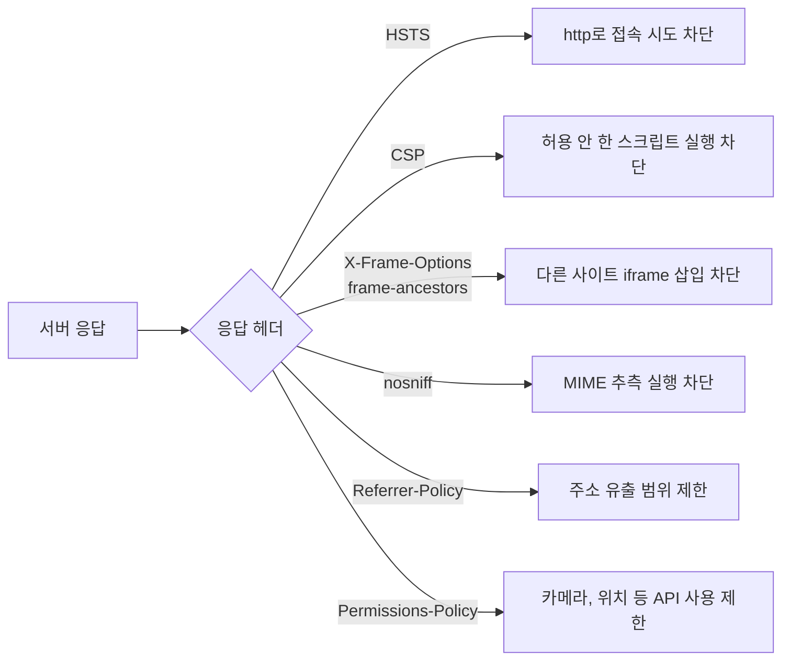
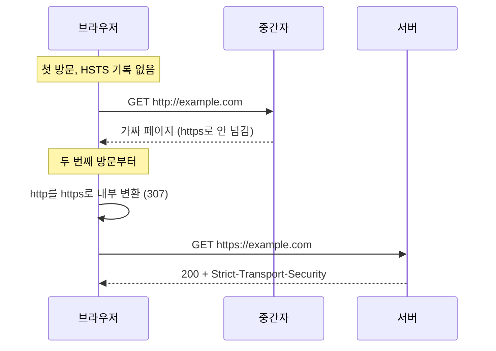

> **웹 보안 기초 시리즈**
> - [입문] [웹사이트 기술 스택 탐지와 핑거프린팅 보안](/how-wappalyzer-works/)
> - [1편] [OWASP Top 10:2025 완전 가이드](/owasp-top10-2025/)
> - [2편] [OWASP API Security Top 10:2023](/owasp-api-security-2023/)
> - [3편] [OWASP LLM Top 10:2025](/owasp-llm-top10-2025/)
> - [4편] [JWT, OAuth, 세션 보안 완전 가이드](/jwt-oauth-session-security/)
> - [5편] **HTTP 보안 헤더 점검** ← 현재 글

---

OWASP Top 10 글에서 "보안 헤더 설정"을 체크리스트 한 줄로 적었다. 그 한 줄을 이 블로그에 직접 대 보았다.

```
$ curl -sI https://leekh8.github.io/
HTTP/1.1 200 OK
Server: GitHub.com
Content-Type: text/html; charset=utf-8
Access-Control-Allow-Origin: *
Strict-Transport-Security: max-age=31556952
Cache-Control: max-age=600
...
```

보안 헤더라고 부를 만한 것은 `Strict-Transport-Security` 하나다. 같은 날 `github.com`을 찍으면 이렇다.

```
$ curl -sI https://github.com/
Strict-Transport-Security: max-age=31536000; includeSubdomains; preload
X-Frame-Options: deny
X-Content-Type-Options: nosniff
Referrer-Policy: origin-when-cross-origin, strict-origin-when-cross-origin
Content-Security-Policy: default-src 'none'; base-uri 'self'; ...
Set-Cookie: _gh_sess=...; path=/; secure; HttpOnly; SameSite=Lax
```

같은 회사가 운영하는 서버인데 차이가 크다. 이유는 뒤에서 다룬다. 결론부터 적으면 **GitHub Pages는 응답 헤더를 사용자가 바꿀 수 없다.** 그래서 이 글은 헤더마다 무엇을 막는지 정리하고, 헤더를 못 거는 환경에서 어디까지 메울 수 있는지를 따로 다룬다.

## 보안 헤더가 하는 일

보안 헤더는 서버가 브라우저에게 "이 페이지는 이렇게 다뤄라"라고 지시하는 값이다. 서버 코드의 취약점을 고치지는 않는다. 취약점이 있어도 **브라우저가 공격 코드를 실행하지 않게 막는 마지막 층**이다.



| 헤더 | 막는 공격 | 권장값 | 이 블로그 |
|------|-----------|--------|:---------:|
| `Strict-Transport-Security` | 다운그레이드, 쿠키 탈취 | `max-age=31536000; includeSubDomains` | ⚠️ max-age만 |
| `Content-Security-Policy` | XSS, 데이터 유출 | 사이트별 설계 | ❌ |
| `X-Frame-Options` | 클릭재킹 | `DENY` | ❌ |
| `X-Content-Type-Options` | MIME 스니핑 | `nosniff` | ❌ |
| `Referrer-Policy` | URL 속 토큰 유출 | `strict-origin-when-cross-origin` | ❌ (브라우저 기본값) |
| `Permissions-Policy` | 삽입된 코드의 기기 API 남용 | `camera=(), microphone=(), geolocation=()` | ❌ |

권장값은 OWASP Secure Headers Project[^owasp-shp]와 MDN[^mdn-headers]을 따랐다.

## HSTS: 첫 접속 한 번은 못 막는다

`Strict-Transport-Security`를 받은 브라우저는 `max-age` 초 동안 그 도메인에 **http로 요청을 보내지 않고 내부에서 https로 바꾼다**[^rfc6797]. 공용 와이파이에서 `http://` 요청을 가로채 가짜 페이지를 보여 주는 공격(SSL stripping)이 여기서 막힌다.

약점은 첫 접속이다. 브라우저가 이 헤더를 한 번도 받은 적이 없으면 첫 요청은 http로 나간다.



이 첫 접속을 막는 방법이 **preload 목록**이다. 브라우저 배포판 안에 "이 도메인은 처음부터 https" 목록을 넣어 둔다. 등록 조건은 hstspreload.org에 적혀 있다[^hstspreload].

- http 요청을 같은 호스트의 https로 리다이렉트
- 모든 하위 도메인이 https 제공
- 기본 도메인 응답에 `max-age` 31536000 이상, `includeSubDomains`, `preload` 세 값

⚠️ **`includeSubDomains`는 하위 도메인을 전부 확인한 뒤에 붙인다.** 사내 시스템 하나가 http로만 열려 있으면 그 시스템은 `max-age` 동안 브라우저에서 열리지 않는다. preload 목록은 빼는 데도 브라우저 배포 주기만큼 걸린다. `max-age=300`처럼 짧게 걸어서 문제가 없는지 본 뒤 늘리는 순서가 안전하다.

이 블로그의 `max-age=31556952`는 365.2425일, 그레고리력 1년이다. `includeSubDomains`와 `preload`는 없다. `*.github.io` 하위 도메인은 사용자마다 주인이 다르니 한 사용자가 결정할 값이 아니고, preload 등록도 등록 가능한 도메인 단위라 `leekh8.github.io` 혼자서는 신청할 수 없다.

## CSP: 가장 강하고 가장 어렵다

`Content-Security-Policy`는 스크립트, 스타일, 이미지, 접속 대상을 어디서 불러와도 되는지 목록으로 정한다[^mdn-csp]. XSS로 `<script>` 하나가 끼어들어도 목록에 없으면 실행되지 않는다.

```http
Content-Security-Policy: default-src 'self'; script-src 'self' https://www.googletagmanager.com; object-src 'none'; base-uri 'self'; frame-ancestors 'none'
```

문제는 **인라인 스크립트**다. CSP를 걸면 HTML 안에 직접 쓴 `<script>...</script>`와 `onclick="..."`이 기본으로 막힌다. 공격자가 넣는 코드도 대부분 인라인이라서다. 이 블로그의 첫 페이지 HTML을 세어 보았다.

```bash
$ curl -s https://leekh8.github.io/ -o index.html
$ grep -aoE '<script[^>]*>' index.html | sort | uniq -c
      2 <script>
      1 <script id="gatsby-script-loader">
      1 <script id="redux-ssr">
      1 <script data-react-helmet="true" type="application/ld+json">
      1 <script async="" src="https://www.googletagmanager.com/gtag/js?id=...">
      1 <script async="" src="https://pagead2.googlesyndication.com/pagead/js/adsbygoogle...">
      4 <script src="/...js" async>   # 번들 4개, 줄여서 표시
$ grep -aoE ' style="' index.html | wc -l
20
```

| 항목 | 개수 | CSP에서 생기는 일 |
|------|-----:|-------------------|
| 실행되는 인라인 `<script>` | 4 | 허용하지 않으면 페이지 동작이 깨짐 |
| JSON-LD (`application/ld+json`) | 1 | 실행되지 않는 데이터라 영향 없음 |
| 외부 출처 스크립트 | 2 | 출처를 목록에 넣어야 함. 광고 스크립트는 다른 도메인에서 또 불러옴 |
| `<style>` 블록 | 2 | `style-src` 허용 필요 (styled-components가 만듦) |
| `style="..."` 속성 | 20 | `style-src`에 `'unsafe-inline'` 필요 |

가장 쉬운 탈출구는 `script-src`에 `'unsafe-inline'`을 넣는 것이다. 그러면 페이지는 다 돈다. 대신 공격자가 넣은 인라인 스크립트도 돈다. **`script-src`에 `'unsafe-inline'`이 있으면 CSP의 XSS 방어는 거의 남지 않는다.**

인라인 스크립트를 살리면서 막는 방법은 두 가지다[^webdev-strict-csp].

| 방식 | 원리 | 조건 |
|------|------|------|
| nonce | 응답마다 새 난수를 만들어 헤더와 `<script nonce="...">`에 같이 넣는다 | 응답을 서버가 매번 만들어야 한다. 정적 파일에는 못 쓴다 |
| hash | 인라인 스크립트 내용의 SHA-256 값을 `script-src`에 넣는다 | 내용이 한 글자라도 바뀌면 값도 바뀐다. 빌드할 때마다 다시 계산해야 한다 |

둘 다 `'strict-dynamic'`과 같이 쓰면 "허용된 스크립트가 불러온 스크립트"도 허용된다. 광고나 태그 관리자처럼 출처를 미리 다 알 수 없는 스크립트를 출처 목록 없이 다룰 수 있다.

✅ CSP를 처음 거는 순서는 이렇다.

1. `Content-Security-Policy-Report-Only`로 건다. 막지 않고 위반만 보고한다
2. 브라우저 콘솔과 보고 수집 주소에 쌓이는 위반을 보고 목록을 고친다
3. 위반이 정상 동작에서 더 안 나오면 `Content-Security-Policy`로 바꾼다

```http
Content-Security-Policy-Report-Only: script-src 'self' 'strict-dynamic' 'sha256-...'; object-src 'none'; base-uri 'self'; report-to csp-endpoint
```

## 클릭재킹: X-Frame-Options와 frame-ancestors

공격자 사이트가 내 사이트를 투명한 `<iframe>`으로 덮고 엉뚱한 버튼을 누르게 만드는 공격이 클릭재킹이다. 막는 헤더는 둘이다.

```http
X-Frame-Options: DENY
Content-Security-Policy: frame-ancestors 'none'
```

`frame-ancestors`가 나중에 나온 표준이고, 둘 다 있으면 브라우저는 `frame-ancestors`를 따른다[^mdn-xfo]. `X-Frame-Options`의 `ALLOW-FROM`은 지원이 끊겼으니 특정 사이트만 허용하려면 `frame-ancestors https://partner.example`을 쓴다. 오래된 브라우저를 위해 둘 다 거는 편이 무난하다.

## nosniff, Referrer-Policy, Permissions-Policy

설정이 한 줄이고 부작용이 거의 없는 세 가지다.

```http
X-Content-Type-Options: nosniff
Referrer-Policy: strict-origin-when-cross-origin
Permissions-Policy: camera=(), microphone=(), geolocation=()
```

- **`nosniff`**: 브라우저가 `Content-Type`을 무시하고 내용을 보고 종류를 추측하는 동작을 끈다. 업로드한 `.txt` 파일 안의 스크립트가 스크립트로 실행되는 경우를 막는다
- **`Referrer-Policy`**: 다른 사이트로 이동할 때 보내는 `Referer`에 전체 주소 대신 도메인만 담는다. 주소에 `?token=...` 같은 값이 들어가는 사이트에서 의미가 있다. `strict-origin-when-cross-origin`은 Chrome 85, Firefox 87부터 기본값이라 헤더가 없어도 최신 브라우저는 이렇게 동작한다[^mdn-referrer]. 그래도 명시해 두면 브라우저마다 다르게 동작할 여지가 없다
- **`Permissions-Policy`**: 페이지와 그 안의 iframe이 쓸 수 있는 기기 기능을 정한다. `()`는 아무에게도 허용하지 않는다는 뜻이다. 광고나 위젯 스크립트가 위치 정보를 요청하는 경우를 막는다

측정해 보면 `github.com`도 `Permissions-Policy`는 보내지 않는다. 권장 목록에 있다고 다 붙어 있지는 않다.

## 쿠키 속성도 헤더다

`Set-Cookie`도 응답 헤더다. 세션 쿠키에는 세 속성이 기본이다. 각 속성이 막는 공격은 [JWT, OAuth, 세션 보안 글](/jwt-oauth-session-security/)에서 다뤘다.

```http
Set-Cookie: __Host-session=abc123; Path=/; Secure; HttpOnly; SameSite=Lax
```

| 속성 | 효과 |
|------|------|
| `Secure` | https 요청에만 쿠키를 보냄 |
| `HttpOnly` | `document.cookie`로 못 읽음. XSS로 세션을 훔치기 어려워짐 |
| `SameSite=Lax` | 다른 사이트에서 시작한 POST 요청에 쿠키를 안 보냄. CSRF 방어 |
| `__Host-` 접두사 | `Secure`, `Path=/`, `Domain` 없음을 브라우저가 강제. 하위 도메인이 쿠키를 덮어쓰지 못함[^mdn-cookie] |

`github.com`의 `_octo` 쿠키에는 `HttpOnly`가 없다. 페이지 스크립트가 읽어야 하는 분석용 쿠키라서다. **세션이나 인증에 쓰는 쿠키만 `HttpOnly`가 필수다.** 점검 도구가 경고를 띄워도 쿠키 용도를 보고 판단한다.

## 이제 쓰지 않는 헤더

인터넷의 오래된 설정 예제를 복사하면 딸려 오는 헤더들이다.

| 헤더 | 상태 | 할 일 |
|------|------|-------|
| `X-XSS-Protection` | 브라우저 XSS 필터는 제거됨. 필터 자체가 정보 유출에 악용된 사례가 있음 | 보내지 않거나 `0`[^owasp-shp] |
| `Public-Key-Pins` (HPKP) | 설정을 잘못하면 사이트가 장기간 열리지 않는 문제로 폐기 | 보내지 않는다 |
| `Expect-CT` | Certificate Transparency가 기본 요구사항이 되면서 폐기 | 보내지 않는다 |

## 헤더를 못 거는 호스팅

GitHub Pages는 응답 헤더 설정 기능이 없다. 이 블로그 응답에 HSTS만 있는 이유다. 남는 수단은 HTML 안의 `<meta http-equiv>`인데, **헤더와 똑같이 동작하지 않는다.**

| 항목 | `<meta http-equiv>`로 | 비고 |
|------|:--------------------:|------|
| CSP 출처 목록 (`script-src` 등) | ✅ | `<meta>` 태그보다 앞에 나온 요소에는 적용 안 됨. `<head>` 맨 위에 둔다 |
| CSP `frame-ancestors` | ❌ | meta에서는 무시된다[^csp3-meta] |
| CSP `report-uri`, `sandbox` | ❌ | meta에서는 무시된다 |
| `X-Frame-Options` | ❌ | meta로 넣으면 무시된다 |
| `Referrer-Policy` | ✅ | `<meta name="referrer" content="...">` |
| HSTS, nosniff, Permissions-Policy | ❌ | 헤더로만 동작 |

즉 GitHub Pages에서는 **클릭재킹 방어를 걸 방법이 없다.** 이 블로그는 로그인도 버튼 동작도 없는 읽기 전용 페이지라 클릭재킹으로 잃을 것이 거의 없지만, 로그인이 있는 서비스라면 GitHub Pages는 맞지 않는다.

헤더가 필요하면 고를 수 있는 길은 셋이다.

| 방법 | 설정 위치 |
|------|-----------|
| 헤더 설정을 지원하는 정적 호스팅 | Netlify `_headers` 파일, Vercel `vercel.json`의 `headers`, Cloudflare Pages `_headers` |
| GitHub Pages 앞에 CDN | Cloudflare 응답 헤더 변환 규칙 (사용자 도메인 필요) |
| 서버 직접 운영 | nginx, Express, Spring 설정 |

## 서버별 설정 예

### nginx

```nginx
server {
    listen 443 ssl;
    # always가 없으면 4xx, 5xx 응답에는 헤더가 안 붙는다
    add_header Strict-Transport-Security "max-age=31536000; includeSubDomains" always;
    add_header X-Content-Type-Options "nosniff" always;
    add_header X-Frame-Options "DENY" always;
    add_header Referrer-Policy "strict-origin-when-cross-origin" always;

    location /api/ {
        # ❌ 여기서 add_header를 하나라도 쓰면 위 server 블록의 4개가 이 location에서 전부 빠진다
        add_header Cache-Control "no-store";
        proxy_pass http://backend;
    }
}
```

⚠️ **nginx의 `add_header`는 하위 블록에 `add_header`가 하나도 없을 때만 상위 값을 물려받는다**[^nginx-add-header]. `location`에 캐시 헤더 하나를 추가했다가 보안 헤더가 그 경로에서만 사라지는 일이 흔하다. 공통 헤더를 파일 하나로 빼고 `include`로 각 블록에 다시 넣거나, 1.29.3 이상이면 `add_header_inherit` 지시어를 쓴다.

### Express

```javascript
const helmet = require("helmet");

// ✅ 기본값으로 CSP, HSTS, nosniff, frameguard 등이 한 번에 붙는다
app.use(helmet());
```

### Vercel

```json
{
  "headers": [
    {
      "source": "/(.*)",
      "headers": [
        { "key": "X-Content-Type-Options", "value": "nosniff" },
        { "key": "X-Frame-Options", "value": "DENY" },
        { "key": "Referrer-Policy", "value": "strict-origin-when-cross-origin" }
      ]
    }
  ]
}
```

Spring Security는 기본으로 여러 헤더를 붙인다. 설정 방법은 [Spring Security 인증 구조 글](/java-spring-authentication/)에 정리했다.

## 점검 스크립트

`curl -sI` 결과를 눈으로 보는 것도 되지만, 기준을 코드로 적어 두면 배포 후 확인에 다시 쓸 수 있다. 표준 라이브러리만 쓴다.

```python
"""응답 헤더 점검기. 표준 라이브러리만 쓴다."""
import re
import sys
import urllib.request


def hsts_ok(v):
    m = re.search(r"max-age=(\d+)", v or "")
    return bool(m) and int(m.group(1)) >= 31536000  # 1년 이상


def csp_ok(v):
    if not v:
        return False
    m = re.search(r"script-src([^;]*)", v)
    # script-src에 'unsafe-inline'이 있으면 XSS 방어가 거의 사라진다
    return not (m and "'unsafe-inline'" in m.group(1))


RULES = [
    ("Strict-Transport-Security", hsts_ok, "max-age 1년 이상"),
    ("Content-Security-Policy", csp_ok, "script-src에 'unsafe-inline' 없음"),
    ("X-Frame-Options", lambda v: (v or "").upper() in ("DENY", "SAMEORIGIN"), "DENY/SAMEORIGIN"),
    ("X-Content-Type-Options", lambda v: (v or "").lower() == "nosniff", "nosniff"),
    ("Referrer-Policy", bool, "있음"),
    ("Permissions-Policy", bool, "있음"),
]


def check(url):
    req = urllib.request.Request(url, headers={"User-Agent": "header-check"})
    with urllib.request.urlopen(req, timeout=10) as res:
        headers = res.headers

    csp = headers.get("Content-Security-Policy") or ""
    for name, ok, rule in RULES:
        value = headers.get(name)
        passed = ok(value)
        # CSP frame-ancestors가 X-Frame-Options를 대신한다
        if name == "X-Frame-Options" and "frame-ancestors" in csp:
            passed = True
        print(f"{'PASS' if passed else 'FAIL'}  {name:<26} {(value or '(없음)')[:40]:<42} 기준: {rule}")

    for cookie in headers.get_all("Set-Cookie") or []:
        attrs = cookie.lower()
        missing = [a for a in ("secure", "httponly", "samesite") if a not in attrs]
        name = cookie.split("=", 1)[0]
        print(f"{'WARN' if missing else 'PASS'}  cookie {name:<19} 빠진 속성: {', '.join(missing) or '없음'}")


if __name__ == "__main__":
    check(sys.argv[1])
```

두 사이트에 돌린 결과다.

```
$ python check_headers.py https://leekh8.github.io/
PASS  Strict-Transport-Security  max-age=31556952                           기준: max-age 1년 이상
FAIL  Content-Security-Policy    (없음)                                     기준: script-src에 'unsafe-inline' 없음
FAIL  X-Frame-Options            (없음)                                     기준: DENY/SAMEORIGIN
FAIL  X-Content-Type-Options     (없음)                                     기준: nosniff
FAIL  Referrer-Policy            (없음)                                     기준: 있음
FAIL  Permissions-Policy         (없음)                                     기준: 있음

$ python check_headers.py https://github.com/
PASS  Strict-Transport-Security  max-age=31536000; includeSubdomains; pre   기준: max-age 1년 이상
PASS  Content-Security-Policy    default-src 'none'; base-uri 'self'; chi   기준: script-src에 'unsafe-inline' 없음
PASS  X-Frame-Options            deny                                       기준: DENY/SAMEORIGIN
PASS  X-Content-Type-Options     nosniff                                    기준: nosniff
PASS  Referrer-Policy            origin-when-cross-origin, strict-origin-   기준: 있음
FAIL  Permissions-Policy         (없음)                                     기준: 있음
PASS  cookie _gh_sess            빠진 속성: 없음
WARN  cookie _octo               빠진 속성: httponly
PASS  cookie logged_in           빠진 속성: 없음
```

이 스크립트는 리다이렉트를 따라간 마지막 응답만 본다. http에서 https로 넘어가는 첫 응답, 로그인 후 페이지, API 경로처럼 헤더가 다를 수 있는 주소는 따로 넣어 돌린다. nginx 상속 문제는 `/api/` 같은 하위 경로를 찍어야 드러난다.

## 정리

1. **보안 헤더는 취약점을 고치지 않는다.** 취약점이 있을 때 브라우저가 공격 코드를 실행하지 않게 막는 마지막 층이다
2. **HSTS는 첫 접속을 못 막는다.** 첫 접속까지 막으려면 preload 목록에 넣어야 하고, `includeSubDomains`는 하위 도메인을 전부 확인한 뒤에 붙인다
3. **`script-src`에 `'unsafe-inline'`을 넣은 CSP는 XSS를 거의 막지 못한다.** 정적 사이트는 hash, 서버 렌더링은 nonce를 쓰고, Report-Only로 먼저 건다
4. **`<meta>`로 거는 CSP는 헤더와 다르다.** `frame-ancestors`가 무시되므로 클릭재킹은 막을 수 없다
5. **nginx는 하위 블록에 `add_header`를 하나만 써도 상위 헤더가 모두 빠진다.** 하위 경로까지 찍어 봐야 보인다

## 실무 체크리스트

- [ ] `curl -sI`로 첫 페이지, 로그인 후 페이지, API 경로, 오류 페이지(404)의 헤더를 각각 확인한다
- [ ] HSTS `max-age`를 짧게 걸어 확인한 뒤 1년으로 늘린다
- [ ] `includeSubDomains` 전에 하위 도메인 목록을 뽑아 전부 https인지 확인한다
- [ ] CSP는 `Content-Security-Policy-Report-Only`로 먼저 건다
- [ ] `script-src`에 `'unsafe-inline'`과 `'unsafe-eval'`이 없는지 본다
- [ ] `object-src 'none'`, `base-uri 'self'`를 넣는다. 거의 아무것도 깨지 않는다
- [ ] 클릭재킹 방어로 `X-Frame-Options: DENY`와 `frame-ancestors 'none'`을 같이 건다
- [ ] `X-Content-Type-Options: nosniff`를 모든 응답에 붙인다
- [ ] 세션 쿠키에 `Secure`, `HttpOnly`, `SameSite`를 붙이고, 가능하면 `__Host-` 접두사를 쓴다
- [ ] 오래된 예제에서 딸려 온 `X-XSS-Protection: 1`, `Public-Key-Pins`, `Expect-CT`를 지운다
- [ ] nginx에서 `location` 블록에 `add_header`를 쓰면 공통 헤더도 거기 다시 넣는다
- [ ] 정적 호스팅이 헤더 설정을 지원하는지 먼저 확인한다. 로그인이 있는 서비스는 지원하는 곳으로 옮긴다

다음 편에서는 CSP를 Report-Only로 걸고 위반 보고를 모아 정책을 좁혀 가는 과정을 다룬다. 인라인 스크립트 hash를 빌드 단계에서 계산하는 방법, 광고와 분석 스크립트를 `'strict-dynamic'`으로 다루는 방법, 위반 보고 중 브라우저 확장 프로그램이 만드는 잡음을 걸러내는 방법을 정리한다.

## 참고문헌

[^owasp-shp]: OWASP. "OWASP Secure Headers Project" (헤더별 권장값, `X-XSS-Protection`은 보내지 않거나 0). https://owasp.org/www-project-secure-headers/
[^mdn-headers]: MDN Web Docs. "HTTP headers". https://developer.mozilla.org/en-US/docs/Web/HTTP/Reference/Headers
[^rfc6797]: IETF. "RFC 6797: HTTP Strict Transport Security (HSTS)". https://www.rfc-editor.org/rfc/rfc6797
[^hstspreload]: HSTS Preload List Submission (등록 조건). https://hstspreload.org/
[^mdn-csp]: MDN Web Docs. "Content Security Policy (CSP)". https://developer.mozilla.org/en-US/docs/Web/HTTP/Guides/CSP
[^webdev-strict-csp]: web.dev. "Mitigate cross-site scripting (XSS) with a strict Content Security Policy (CSP)" (nonce 방식과 hash 방식, `'strict-dynamic'`). https://web.dev/articles/strict-csp
[^mdn-xfo]: MDN Web Docs. "X-Frame-Options" (`frame-ancestors`가 이 헤더를 대체한다). https://developer.mozilla.org/en-US/docs/Web/HTTP/Reference/Headers/X-Frame-Options
[^mdn-referrer]: MDN Web Docs. "Referrer-Policy" (기본값 `strict-origin-when-cross-origin`). https://developer.mozilla.org/en-US/docs/Web/HTTP/Reference/Headers/Referrer-Policy
[^mdn-cookie]: MDN Web Docs. "Set-Cookie - Cookie prefixes". https://developer.mozilla.org/en-US/docs/Web/HTTP/Reference/Headers/Set-Cookie
[^csp3-meta]: W3C. "Content Security Policy Level 3 - Delivering a policy via the meta element" (`frame-ancestors`, `report-uri`, `sandbox`는 meta에서 지원하지 않는다). https://www.w3.org/TR/CSP3/#meta-element
[^nginx-add-header]: nginx. "Module ngx_http_headers_module - add_header" (현재 단계에 `add_header`가 없을 때만 상위 단계 값을 물려받는다). https://nginx.org/en/docs/http/ngx_http_headers_module.html#add_header

---

## 이어서 읽기

- [OWASP Top 10:2025 — A02 보안 설정 오류](/owasp-top10-2025/)
- [JWT, OAuth, 세션 보안 완전 가이드](/jwt-oauth-session-security/)
- [웹사이트 기술 스택 탐지와 핑거프린팅 보안](/how-wappalyzer-works/)
