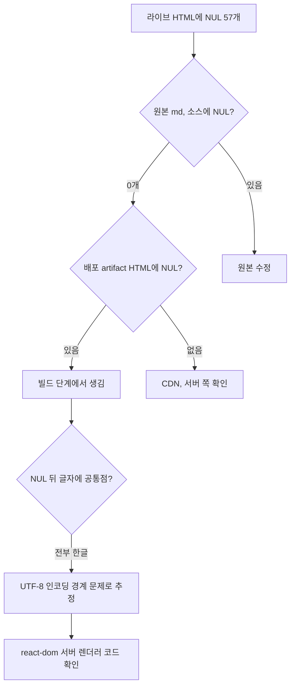
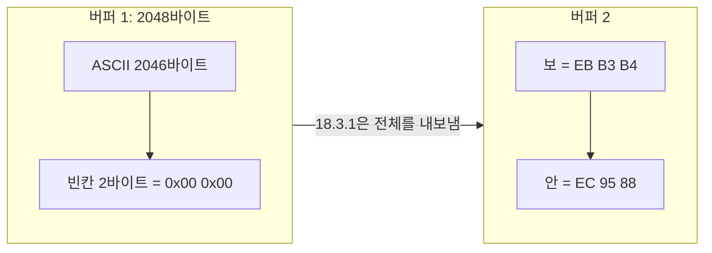

지난주 [HTTP 보안 헤더 글](/http-security-headers/)을 발행하고 실제 사이트에서 렌더링을 확인했다. 본문, 표, 각주, Mermaid는 모두 정상이었다. 그런데 글 아래 "보안 헤더" 태그를 누르면 태그 목록이 걸러지지 않았다.

링크 주소를 바이트로 찍어 보니 `/tags/?q=` 와 `보안 헤더` 사이에 `0x00` 한 바이트가 끼어 있었다. 화면에는 아무것도 안 보이는 NUL 문자다. 이 글 하나의 문제가 아니었다.

| 항목 | 값 |
|---|---|
| 배포본 HTML 파일 | 99개 |
| NUL이 들어 있는 파일 | **29개** |
| NUL 개수 | **57개** |
| 그중 태그 링크 주소 안 | **11개** |
| NUL이 붙은 위치 | 전부 한글 글자 바로 앞 |
| 원본 md, 소스 코드의 NUL | 0개 |

다른 글의 태그에서도 같은 일이 있었다. 아래에서 `␀`는 NUL 한 바이트를 뜻한다.

```text
웹 스크␀␀래핑
웹 ␀␀개발
프롬프트 ␀인젝션
/tags/?q=␀보안 헤더
```

결론부터 적으면 원인은 react-dom 18.3.1의 서버 렌더러 버그다. React 쪽에서는 2023년 2월에 고쳤지만 그 수정은 19에만 들어갔다.[^react-26228] 18.x를 쓰는 정적 사이트 생성기는 지금도 같은 일을 겪는다.

## 화면은 멀쩡한데 링크만 깨지는 이유

NUL이 57개나 있었는데 화면에서 이상한 글자가 하나도 안 보였다. HTML 파서가 NUL을 만나는 위치에 따라 다르게 처리하기 때문이다. HTML 표준은 이 경우를 `unexpected-null-character` 파싱 오류로 정하고, 위치별 처리를 따로 적어 두었다.[^whatwg-parsing]

| NUL 위치 | 표준이 정한 처리 | 사용자가 보는 결과 |
|---|---|---|
| 본문 텍스트 (`<p>`, `<a>` 안의 글자) | 토큰을 버린다 | 아무 변화 없음 |
| 속성값 (`href`, `content` 등) | `U+FFFD`(�)로 바꾼다 | **링크 주소, 메타 값이 바뀜** |
| `<title>` 안 | `U+FFFD`로 바꾼다 | 탭 제목, 검색 결과 제목에 � |
| `<script>` 안 | `U+FFFD`로 바꾼다 | JSON-LD 같은 문자열에 � |

그래서 태그 이름 텍스트는 멀쩡하게 보이고, 같은 태그 이름이 들어간 `href`만 `/tags/?q=�보안 헤더`가 된다. 태그 페이지는 `q` 값과 태그 이름을 비교하므로 일치하는 태그가 없다.

React가 하이드레이션 단계에서 고쳐 줄 것 같지만 그렇지 않다. React 공식 문서는 서버 HTML과 클라이언트 렌더링 결과가 다를 때 **속성 차이를 바로잡는다는 보장이 없다**고 적고 있다.[^react-hydrate] 개발 모드에서 경고만 하고, 운영 빌드에서는 깨진 `href`가 그대로 남는다.

> ⚠️ **주의**: 본문 텍스트에 섞인 NUL은 브라우저 화면만 봐서는 찾을 수 없다. `curl`로 받은 HTML을 바이트 단위로 세야 보인다.

## 빌드 문제인지 CDN 문제인지부터 가른다

배포된 HTML에 이상한 바이트가 있으면 범위를 먼저 좁힌다. 원본, 빌드 결과물, 배포된 응답 중 어디서 처음 생기는지 보면 된다.



GitHub Actions의 배포 artifact를 내려받아 세어 보니 HTML 안에 이미 NUL이 있었다. CDN이 아니라 빌드가 만든 것이다. NUL 바로 뒤 글자는 전부 한글이었다. 한글은 UTF-8로 3바이트이므로, 바이트를 나눠 쓰는 경계에서 뭔가 어긋나는 것으로 범위를 좁혔다.

세는 방법은 단순하다.

```python
from pathlib import Path

# 빌드 결과물의 모든 html에서 0x00 개수를 센다
total = 0
for f in Path("public").rglob("*.html"):
    n = f.read_bytes().count(b"\x00")
    if n:
        print(f, n)
        total += n
print("NUL 합계:", total)
```

## 원인: 2048바이트 버퍼와 3바이트 한글

Gatsby 5는 정적 HTML을 만들 때 `renderToPipeableStream`을 쓴다.[^gatsby-static-entry] 이 함수는 출력을 문자열 하나로 모으지 않는다. 텍스트 조각을 받을 때마다 2048바이트짜리 `Uint8Array`에 UTF-8로 채우고, 다 차면 내보낸다.

문제는 남은 칸이 1~2바이트인데 다음 글자가 3바이트 한글일 때다. `TextEncoder.encodeInto()`는 글자를 반으로 쪼개 쓰지 않는다. 들어가는 데까지만 쓰고 멈춘다.[^mdn-encodeinto] 그다음 react-dom 18.3.1은 버퍼를 비우는데, **채운 만큼이 아니라 버퍼 전체를** 내보낸다.

```js
// react-dom 18.3.1 cjs/react-dom-server.node.development.js, writeStringChunk
var _textEncoder$encodeIn = textEncoder.encodeInto(stringChunk, target),
    read = _textEncoder$encodeIn.read,
    written = _textEncoder$encodeIn.written;

writtenBytes += written;

if (read < stringChunk.length) {
  // ❌ 2048바이트 전체를 내보낸다. 못 채운 1~2칸은 0으로 남아 있다
  writeToDestination(destination, currentView);
  currentView = new Uint8Array(VIEW_SIZE);
  writtenBytes = textEncoder.encodeInto(stringChunk.slice(read), currentView).written;
}
```

React 19의 같은 자리는 이렇게 바뀌어 있다.

```js
// react-dom 19.0.0
read < chunk.length &&
  // ✅ 실제로 쓴 writtenBytes까지만 내보낸다
  (writeToDestination(destination, currentView.subarray(0, writtenBytes)),
  (currentView = new Uint8Array(2048)),
  (writtenBytes = textEncoder.encodeInto(chunk.slice(read), currentView).written));
```

버퍼 끝에서 일어나는 일을 바이트로 그리면 이렇다.



`보`는 3바이트라 남은 2칸에 안 들어간다. 18.3.1은 2칸이 빈 채로 버퍼 1을 통째로 내보내고, `보`는 버퍼 2 맨 앞에 온전히 쓴다. 그래서 글자는 깨지지 않고 **글자 앞에 NUL만 덧붙는다.** 위에서 본 `웹 스크␀␀래핑`이 정확히 이 모양이다.

### 재현

react-dom을 설치하지 않고 이 로직만 떼어 Node로 돌려 볼 수 있다. ASCII를 100바이트씩 나눠 쓰고 마지막에 `보안`을 쓴다. 렌더러는 실제로 텍스트 노드, 속성값 같은 작은 조각을 연달아 쓰므로 조각을 나눠야 재현된다. 682자가 넘는 조각은 버퍼를 거치지 않고 바로 내보내는 다른 길로 빠진다.

```js
const VIEW_SIZE = 2048
function makeWriter(fixed) {
  const out = []
  let view = new Uint8Array(VIEW_SIZE), written = 0
  const enc = new TextEncoder()
  function write(chunk) {
    const target = written > 0 ? view.subarray(written) : view
    const { read, written: w } = enc.encodeInto(chunk, target)
    written += w
    if (read < chunk.length) {
      out.push(fixed ? view.subarray(0, written) : view) // 18.3.1은 view 전체
      view = new Uint8Array(VIEW_SIZE)
      written = enc.encodeInto(chunk.slice(read), view).written
    }
    if (written === VIEW_SIZE) { out.push(view); view = new Uint8Array(VIEW_SIZE); written = 0 }
  }
  const end = () => Buffer.concat([...out, view.subarray(0, written)])
  return { write, end }
}

for (const pad of [2045, 2046, 2047]) {
  for (const fixed of [false, true]) {
    const w = makeWriter(fixed)
    for (let i = 0; i < pad; i += 100) w.write("a".repeat(Math.min(100, pad - i)))
    w.write("보안")
    const nul = w.end().filter(b => b === 0).length
    console.log(`ASCII ${pad}바이트 뒤 한글, ${fixed ? "19  " : "18.3"}: NUL ${nul}개`)
  }
}
```

| 한글 앞까지 채운 바이트 | 남은 칸 | 18.3.1 | 19 |
|---:|---:|---:|---:|
| 2045 | 3 | 0 | 0 |
| 2046 | 2 | **2** | 0 |
| 2047 | 1 | **1** | 0 |

남은 칸이 3바이트 이상이면 한글이 들어가므로 아무 일도 없다. 1~2바이트일 때만 그 수만큼 NUL이 생긴다. 4바이트인 이모지는 남은 칸이 1~3바이트일 때 생긴다. ASCII는 1바이트라 절대 안 생긴다. 영어 위주 사이트에서는 거의 안 보이고, 한글, 일본어, 중국어 사이트나 `—`, `→` 같은 기호를 많이 쓰는 문서에서 보이는 이유다.

### 왜 18에서 고쳐지지 않았나

| 시점 | 일 |
|---|---|
| 18.1.0 | 스트리밍 성능 개선(#24291)으로 버퍼 방식이 들어오면서 버그 시작[^react-31134] |
| 2023-02-24 | 수정 PR #26228 "Fix null bytes written at text chunk boundaries" 병합[^react-26228] |
| 2024-04-26 | 18.3.1 배포. 18.3은 19 이전 경고를 추가한 판이라 이 수정은 없음[^react-31134] |
| 2024-10 | Docusaurus 메인테이너가 같은 증상을 이슈 #31134로 보고, "19에서 고쳐졌다"며 닫음[^react-31134] |
| 2024-12-05 | 19.0.0 배포 |

18.3.1이 18의 마지막 판이다. 18에 머무는 한 react-dom 버전을 올려서 고칠 방법은 없다. 같은 이슈에서 React 팀의 sebmarkbage는 서버 출력과 클라이언트 렌더링이 달라지는 실제 버그라고 인정했다.[^react-31134]

`renderToString`은 버퍼를 쓰지 않고 문자열을 이어 붙이므로 이 문제가 없다. 같은 이슈에서 `renderToReadableStream`도 `renderToString`과 같은 결과를 냈다고 보고됐다.

## 고칠 수 있는 방법 네 가지

| 방법 | 장점 | 이 블로그에서 걸리는 점 |
|---|---|---|
| React 19로 올린다 | 원인이 사라진다 | Gatsby는 5.16.0부터 React 19를 허용하지만, 쓰고 있는 `react-redux` 8, `react-spring` 9, `utterances-react-component` 1.0이 React 18까지만 받는다 |
| `patch-package`로 18.3.1에 #26228을 옮긴다 | 원인 코드만 고친다 | 개발, 운영 빌드 파일을 둘 다 고쳐야 하고, 운영 파일은 압축돼 있다. 의존성을 다시 받을 때마다 패치가 맞는지 확인해야 한다 |
| 렌더 함수를 `renderToString` 등으로 바꾼다 | 버퍼를 안 거친다 | Gatsby 내부 `static-entry.js`를 고쳐야 한다. Docusaurus는 이 방법을 PR #10562로 시도했다가 19 업그레이드로 해결된다며 닫았다[^docusaurus-10562] |
| **빌드 후 HTML에서 NUL을 지운다** | 설정 몇 줄, 의존성 변경 없음 | 원인은 남는다. 대신 CI 검사로 다시 들어오면 바로 잡는다 |

네 번째를 골랐다. 지워도 되는 근거는 두 가지다.

1. **덧붙은 것은 빈칸의 0뿐이다.** 글자는 다음 버퍼에 온전히 들어가므로 빠진 바이트가 없다. NUL을 지우면 원래 나와야 했던 출력과 바이트 단위로 같다.
2. **UTF-8에서 `0x00`은 `U+0000`일 때만 나온다.** 다른 글자의 여러 바이트 중 하나로 `0x00`이 들어가는 일은 없다. UTF-8에서 2바이트 이상인 글자는 모든 바이트가 `0x80` 이상이기 때문이다.[^rfc3629] HTML에서 `U+0000`을 일부러 쓸 일도 없다.

React 19로 올리는 것이 근본 해결이다. 막고 있는 의존성 셋은 각각 상위 버전(`react-redux` 9, `@react-spring/web` 10)이 있거나 교체할 수 있으므로, 업그레이드는 따로 진행할 일로 남겼다.

## onPostBuild로 지우고 CI로 다시 본다

Gatsby의 `onPostBuild`는 `public/` 폴더가 다 만들어진 뒤에 실행된다.[^gatsby-onpostbuild] 여기서 모든 `.html`을 돌며 `0x00`을 지운다.

```js
// gatsby-node.js
const fs = require("fs")
const path = require("path")

function stripNulBytes(dir) {
  let files = 0
  let bytes = 0
  for (const entry of fs.readdirSync(dir, { withFileTypes: true })) {
    const full = path.join(dir, entry.name)
    if (entry.isDirectory()) {
      const sub = stripNulBytes(full)
      files += sub.files
      bytes += sub.bytes
    } else if (entry.name.endsWith(".html")) {
      const buf = fs.readFileSync(full)
      if (!buf.includes(0)) continue
      const clean = buf.filter(b => b !== 0)
      fs.writeFileSync(full, clean)
      files += 1
      bytes += buf.length - clean.length
    }
  }
  return { files, bytes }
}

exports.onPostBuild = ({ reporter }) => {
  const { files, bytes } = stripNulBytes(path.join(__dirname, "public"))
  reporter.info(`NUL 바이트 제거: html ${files}개에서 ${bytes}바이트`)
}
```

`buf.filter()`는 문자열로 디코딩하지 않고 바이트 배열에서 바로 지운다. 문자열로 바꿨다가 다시 인코딩하면 원래 바이트와 달라질 여지가 생긴다.

지우는 단계가 나중에 빠지거나 바뀌면 NUL이 다시 들어온다. 그런데 본문 텍스트에 섞인 NUL은 화면에 안 보이므로 아무도 모른다. 그래서 빌드 검증 스크립트에 검사를 하나 더 넣었다. `index.html`만이 아니라 모든 HTML을 본다.

```js
// scripts/verify-build-seo.js
function checkNulBytes() {
  const problems = []
  let checked = 0
  for (const file of walkAllHtml(PUBLIC_DIR)) {
    checked += 1
    const buf = fs.readFileSync(file)
    let count = 0
    for (let i = buf.indexOf(0); i !== -1; i = buf.indexOf(0, i + 1)) count += 1
    if (count > 0) problems.push(`${file}: NUL 바이트 ${count}개`)
  }
  return { checked, problems }
}
```

검사를 믿으려면 검사가 실패하는 것부터 봐야 한다. 고치기 전 배포본에 먼저 돌렸다.

| 확인 | 결과 |
|---|---|
| 고치기 전 배포본에 새 검사 | **29개 파일에서 실패** (검사가 잡는다) |
| 같은 배포본에서 NUL을 지운 뒤 | 0건 |
| 수정 후 CD 빌드 로그 | `NUL 바이트 제거: html 30개에서 59바이트` |
| 수정 후 CI 검사 | HTML 104개, NUL 0건 |
| 실제 사이트 7개 페이지 | NUL 0개, 태그 링크 `/tags/?q=보안 헤더` 정상 |

수정 후 빌드에서 지운 양(30개, 59바이트)이 처음 센 값(29개, 57개)과 조금 다르다. 그사이 새 글이 하나 늘었고, 버퍼 경계는 HTML 전체 길이에 따라 움직이므로 어느 글자가 경계에 걸릴지는 빌드마다 바뀐다. 이 버그가 생겼다 안 생겼다 하는 것도 같은 이유다. 글 앞부분을 조금 고쳤더니 멀리 떨어진 곳의 NUL이 사라졌다는 보고도 같은 이슈에 있다.[^react-31134]

## 정리

1. **React 18.1~18.3.1의 `renderToPipeableStream`은 한글 앞에 NUL을 끼워 넣을 수 있다.** 2048바이트 버퍼에 3바이트 글자가 안 들어갈 때 버퍼 전체를 내보내기 때문이다
2. **HTML 파서는 위치마다 NUL을 다르게 처리한다.** 본문에서는 버려서 안 보이고, 속성값, `<title>`, `<script>`에서는 �로 바꾼다. 그래서 화면은 멀쩡하고 링크만 깨진다
3. **하이드레이션은 깨진 속성을 고쳐 주지 않는다.** 서버 HTML에 들어간 `href`가 그대로 남는다
4. **수정은 React 19에만 있다.** 18.3.1이 18의 마지막 판이다
5. **NUL만 지우면 원래 출력과 같다.** 덧붙은 것은 빈칸의 0뿐이고 UTF-8에서 `0x00`은 다른 글자 안에 나오지 않는다
6. **검사는 실패하는 것부터 확인한다.** 고치기 전 산출물에 돌려 잡히는지 본 뒤 CI에 넣는다

### 실무 체크리스트

- [ ] React 18 스트리밍 SSR(`renderToPipeableStream`)을 쓰는 사이트라면 빌드 산출물 HTML의 `0x00` 개수를 센다
- [ ] 브라우저 화면이 아니라 `curl`로 받은 바이트로 확인한다. 본문 텍스트의 NUL은 화면에 안 보인다
- [ ] 이상한 바이트가 있으면 원본, 빌드 산출물, 배포 응답 순으로 어디서 처음 생기는지 가른다
- [ ] `href`, `<title>`, `<meta content>`, JSON-LD에 `U+FFFD`(�)가 있는지 본다. NUL이 바뀐 흔적이다
- [ ] 바이트를 지울 때는 문자열로 디코딩하지 말고 바이트 배열에서 지운다
- [ ] 빌드 후처리가 빠져도 알 수 있게 CI에 "NUL 0개" 검사를 넣는다. 고치기 전 산출물에서 실패하는지 먼저 본다
- [ ] React 19로 못 올리는 이유를 의존성 단위로 적어 둔다. 막는 패키지가 풀리면 후처리를 걷어낸다

다음 글은 순환 순서대로 네트워크 쪽을 다룬다. [HTTP 보안 헤더 글](/http-security-headers/)에서 예고한 CSP Report-Only 편은 다음 보안 차례에 웹 보안 기초 시리즈로 이어진다.

## 참고문헌

[^react-26228]: facebook/react. "[Fizz Node] Fix null bytes written at text chunk boundaries" (PR #26228, 2023-02-24 병합). https://github.com/facebook/react/pull/26228
[^react-31134]: facebook/react. "Bug: React 18 emit null chars in `renderToPipeableStream`" (Issue #31134, 18.1.0부터 발생, 19에서 수정, 18.x 백포트 없음). https://github.com/facebook/react/issues/31134
[^whatwg-parsing]: WHATWG. "HTML Standard - 13.2 Parsing HTML documents" (`unexpected-null-character`, Data state, RCDATA state, Script data state, Attribute value state, "in body" 삽입 모드의 U+0000 처리). https://html.spec.whatwg.org/multipage/parsing.html
[^react-hydrate]: React. "hydrateRoot - Caveats" ("There are no guarantees that attribute differences will be patched up in case of mismatches"). https://react.dev/reference/react-dom/client/hydrateRoot
[^gatsby-static-entry]: gatsbyjs/gatsby. `packages/gatsby/cache-dir/static-entry.js` (`renderToPipeableStream`으로 페이지 HTML 생성). https://github.com/gatsbyjs/gatsby/blob/master/packages/gatsby/cache-dir/static-entry.js
[^mdn-encodeinto]: MDN Web Docs. "TextEncoder: encodeInto() method" (대상 배열에 들어가는 만큼만 쓰고 `read`, `written`을 돌려준다). https://developer.mozilla.org/en-US/docs/Web/API/TextEncoder/encodeInto
[^docusaurus-10562]: facebook/docusaurus. "fix(core): fix React rendering null chars in HTML output - Use `renderToReadableStream`" (PR #10562, 병합하지 않고 닫음). https://github.com/facebook/docusaurus/pull/10562
[^rfc3629]: IETF. "RFC 3629 - UTF-8, a transformation format of ISO 10646" (여러 바이트 글자의 각 바이트는 최상위 비트가 1). https://www.rfc-editor.org/rfc/rfc3629
[^gatsby-onpostbuild]: Gatsby. "Gatsby Node APIs - onPostBuild" (빌드가 끝난 뒤 실행). https://www.gatsbyjs.com/docs/reference/config-files/gatsby-node/#onPostBuild

---

## 이어서 읽기

- [HTTP 보안 헤더 점검: 내 블로그 응답에는 HSTS 하나만 붙어 있었다](/http-security-headers/)
- [Gatsby 블로그 SEO 설정 가이드: Google Search Console, sitemap, robots.txt](/gatsby-seo-setup/)
- [다크 모드에서 글자가 배경에 묻힌다: 예외 선택자 19개와 인라인 스타일 38개가 사라진 토큰 정리기](/dark-mode-text-invisible-design-tokens/)
